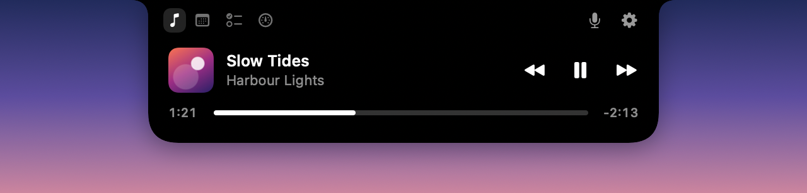
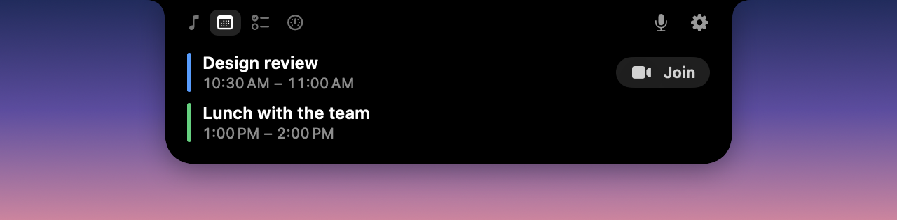
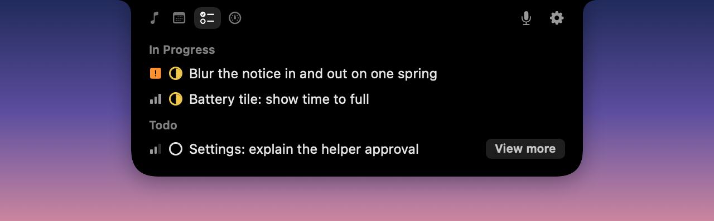
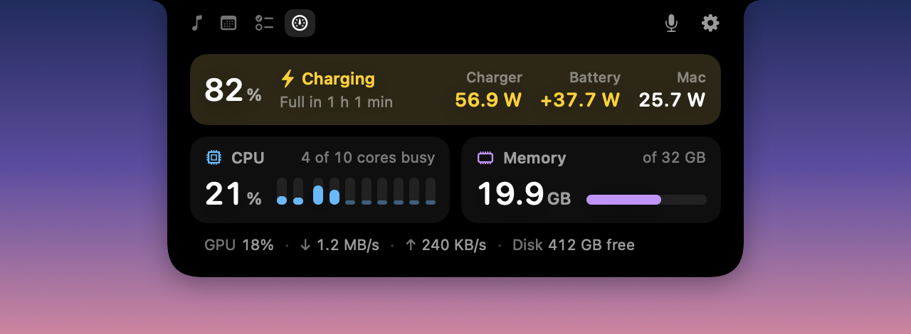

# Clove

A Dynamic Island for the MacBook notch. Clove turns the notch into a small black island that
shows what's playing, what's next and what your Mac is doing, and grows when you move the
pointer to it.

<p align="center">
  
</p>

## What it does

**When you hover over the notch**, the island opens to one of four pages:

| | |
|---|---|
|  | **Calendar.** Your next events today and tomorrow, with a Join button for Zoom, Meet, Teams, Webex and FaceTime links. |
|  | **Tasks.** Your Linear issues for the current cycle, grouped by status. Press ⌥ Space to dictate a voice note; the on-device model turns it into issue changes you review before anything is sent. |
|  | **System.** Battery, charger and power draw, per-core CPU, memory, GPU, network and free disk space. Sampled only while the page is open. |

**When something happens**, the island shows it beside the notch for a few seconds:

| | |
|---|---|
|  | Now playing in Music or Spotify. |
|  | Plugging in: a band of gold light falls through the island. |
|  | Low battery at 20 % and 10 %. Click it to turn on Low Power Mode… |
|  | …and it turns gold. |
|  | Volume and brightness, in place of the macOS indicators. |

It also shows headphones and speakers connecting, meetings about to start and Linear issues
coming due. Each one can be turned off in Settings.

## Requirements

- macOS 26 or later.
- A MacBook with a notch is best. On other displays the island sits at the top centre of the
  menu bar.
- Voice notes need Apple Intelligence and a Linear account.

## Two builds

Clove builds in two flavours from the same code:

| | App Store | Direct download |
|---|---|---|
| Bundle id | `app.clove.Clove` | `app.clove.Clove.direct` |
| Sandbox | Yes | No (hardened runtime, notarised) |
| Brightness keys | Left to macOS | Taken over, with Clove's own indicator |
| Battery figures | From the IORegistry | Live power from the SMC as well |
| Low-battery click | Opens Battery settings | Turns on Low Power Mode through a small helper |

The direct build is compiled with the `DIRECT` flag, and everything that uses private API or
needs root sits inside `#if DIRECT`, so none of it is in the App Store binary.

The Low Power Mode helper is a launchd daemon registered with `SMAppService`. macOS asks you to
allow it once, under System Settings › General › Login Items. It only accepts connections
from Clove signed by the same team, and it can only do one thing: set Low Power Mode on battery
(`pmset -b`). To remove it, turn it off in Login Items.

## Building

You need Xcode 26.

```bash
scripts/build.sh
```

That builds the App Store flavour into `build/Clove.app`. Add `--direct` for the direct
flavour (`build/Direct/Clove.app`) and `--install` to replace `/Applications/Clove.app` and
relaunch it. If you have an Apple Development certificate, dev builds are signed with it, so
permissions you grant survive rebuilds. Without one, they are signed ad hoc.

You can also open `Clove/Clove.xcodeproj` in Xcode and run the `Clove` scheme, which builds the
App Store flavour.

In debug builds, `open clove://preview/low-battery` or `open clove://preview/charging` shows
that activity without unplugging or draining the battery. `open clove://settings` opens
Settings in any build.

To ship:

- `scripts/release.sh`: archives and exports a signed App Store package. Needs `TEAM_ID`.
- `scripts/release-direct.sh`: signs with Developer ID, notarises and staples a zip for direct
  download. Needs `TEAM_ID` and `NOTARY_PROFILE`; see the comment at the top of the script.

## Permissions

Clove asks for each permission the first time a feature needs it:

| Permission | Used for |
|---|---|
| Calendars | The calendar page and meeting reminders |
| Automation (Music, Spotify) | Reading and controlling what's playing |
| Input Monitoring and Accessibility | Handling the volume (and brightness) keys, so macOS's own indicator stays hidden |
| Microphone | Voice notes |

Everything runs on your Mac. Your Linear API key is kept in the keychain, and voice notes are
transcribed and understood on device. Clove has no analytics. The only servers it talks to are
Linear's API, if you connect it, and Spotify's, for album art.

## Project layout

```
Clove/
  Sources/Clove/
    App/          app delegate, menu bar item
    Notch/        the island: window, geometry, shape, view model
    Activities/   live activities: charging, low battery, volume, audio devices
    Calendar/     EventKit and the calendar page
    Media/        Music and Spotify through AppleScript
    System/       battery and performance readings
    Tasks/        Linear client and the tasks page
    Voice/        voice notes: recording, transcription, planning, review
    Settings/     the Settings window
    Design/       motion, layout constants
  Helper/         the direct build's Low Power Mode daemon
  Support/        Info.plist, entitlements, privacy manifest, app icon
scripts/          build, sign and release
```

`Design/Motion.swift` holds every animation in the app; its header explains the rules they
follow.

## Credits

The low-battery notice follows Raphael Salaja's recreation of the iOS 26 low-battery
notification ([write-up](https://www.raphaelsalaja.com/work/low-battery-notification)).

## License

[MIT](LICENSE)
